# Admin deep statistics — implementation report

**Branch:** `feat/admin-deep-stats` (not pushed, not deployed)

The vote path was not changed. No migrations were added or edited. All new
endpoints are admin-only (`AdminUser`) and every statistic is computed from the
existing `tracks`, `seen_pairs`, `votes`, `users` and `playlists` tables. The
only writes are `app_settings` rows from the Settings screen.

## What was added

### Backend

| Area | Endpoint | Notes |
|---|---|---|
| Duel feed | `GET /api/admin/duels` | Newest first, includes no-vote rows. `limit`, `offset`, `only=all\|voted\|no_vote\|upset`, `sort=recent\|upsets`, `user`, `q`, `track_id`, `hours`, `from`, `to`. Full per-row detail. |
| Song deep dive | `GET /api/admin/songs/{id}` | Summary, 24h/7d rank, expected wins/form, best win/worst loss, rating series and a paginated duel history (`limit`, `offset`). |
| Standings | `GET /api/admin/standings` | Extended rows: win %, 24h rank change, form, no-vote rate, last duel time. |
| Pairing health | `GET /api/admin/pairing` | Rank buckets, served/target/unweighted shares, settling evenness and forecast, bottom share, rating-gap quality (`hours`, `from`, `lookback_hours`). |
| Progress | `GET /api/admin/progress` | 24h/7d duel pace, duels per song vs target, reveal projection/ETA, ranking stability and 14-day convergence. |
| Song insights | `GET /api/admin/song-insights` | Most no-voted, preview impact, over/under performers, never-voted/fewest duels, distributions. |
| Vote quality | `GET /api/admin/vote-quality` | Upset/no-vote rates, decision medians/P90, left/right bias, flagged vote share, local-time heatmap (`tz`). |
| Voter table | `GET /api/admin/voters` | Sortable decision/session/flag metrics (`limit`, `offset`, `q`, `sort`). |
| Voter detail | `GET /api/admin/voters/{id}` | Histogram, per-session P10–P90 band, tiredness curve, sessions, heatmap, recent duels (`tz`, `duel_limit`). |
| Crowd level | `GET /api/admin/crowd` | Decision-time, agreement and session-length distributions plus crowd tiredness. |

New modules: `api/analytics.rs` (pure, unit-tested maths), `api/admin_stats.rs`
(duels, songs, standings, pairing, progress, insights, vote quality) and
`api/admin_voters.rs` (voters, detail, crowd, flags). Routes were added in
`api/mod.rs`; `dashboard.rs` and `AdminOverview.tsx` were not inflated.

`settings.rs` now exposes one `rank_weighting_config()` used by both
`matchup.rs` and the pairing statistics. `PAIR_SQL` is unchanged; `matchup.rs`
only binds the configured values. Statistics-only settings are read through
`stats_config()` and never reach the duel path.

Expensive aggregates are cached for 45 seconds in the existing in-process
response cache, and the UI displays `as of hh:mm`. `update_settings` clears the
cache so threshold changes are visible immediately. Heavy handlers take the
existing `heavy_work` semaphore permit.

### Frontend

- New **Duels** section: compact feed, expandable details, filters, biggest
  upsets.
- New **Pairing health** section: status, bucket bars/table, settling and
  forecast, pairing quality.
- **Voters** rewritten around behaviour metrics, flag summary, sortable columns,
  a “more columns” toggle, crowd panels and a full voter detail drawer. The old
  account-management actions are preserved behind **Manage**.
- **Standings** gets a “more columns” toggle and song links.
- **Overview** gains vote-quality/heatmap, progress/forecast, ranking stability
  and song-insight panels. The old hourly chart was replaced by the weekday×hour
  heatmap, and the old recent-picks panel now links to the richer Duels feed.
- A reusable song deep-dive drawer is opened from Standings and the duel feed.
- All paginated admin lists (duels, voters, standings and a song's duel history)
  now have numbered page controls: Previous / a page-number field with Go / Next.
- The active admin tab is stored in the URL as `?section=duels`, `?section=voters`,
  etc., so reload, bookmarking and browser back/forward return to the same tab.
- **Settings** is grouped into Live pairing and Statistics, shows defaults and
  ranges, has a reset-to-defaults button, and asks for confirmation before any
  live-pairing change.

### Settings (all stored in `app_settings`)

| Key | Default | Range | Effect |
|---|---:|---:|---|
| `daily_streak_goal` | 3 | 1–100 | Existing streak goal |
| `rank_weighting` | on | on/off | Live duel selection |
| `rank_weight_strength` | 6 | 0–12 | Live duel selection |
| `rank_weight_scale` | 500 | 100–2,000 | Live duel selection |
| `rank_weight_min_avg` | 6 | 0–30 | Live duel selection |
| `stats_session_gap_minutes` | 15 | 5–120 | Sessions / idle exclusion |
| `stats_fast_decision_seconds` | 1.5 | 0.5–10 | Fast-clicker flag |
| `stats_upset_threshold_pct` | 35 | 10–49 | Upset rule |
| `stats_side_bias_margin_pct` | 15 | 5–40 | Side-bias flag |
| `stats_low_agreement_pct` | 55 | 50–80 | Low-agreement flag |
| `stats_min_votes_for_flags` | 30 | 5–500 | Low-agreement sample guard |
| `stats_target_duels_per_song` | 30 | 5–200 | Progress / forecast target |

Values are clamped server-side; every changed key is logged with
`admin_id` and `admin_username`.

## Verification

### Unit tests

`cargo fmt --all -- --check` passes. `cargo clippy --all-targets` has no
warnings. `cargo test` passes: **63 passed, 0 failed**. The new pure-function
tests cover win chance, upset rule, A/B side mapping, rank weight, bucket
boundaries, evenness, settling status, the duels-left formula and its guards,
session splitting, idle exclusion, flag rules, percentile/median maths, rank
maps, rating timelines and settings parsing/clamping.

Output: [`backend-checks.txt`](backend-checks.txt). Frontend: `npm run build`
succeeds (`tsc --noEmit` + Vite); output in [`npm-build.txt`](npm-build.txt).

### Seeded database

A throwaway Postgres 16 database was seeded twice:

- **Correctness seed:** 2,200 tracks, 50 voters, 19,995 `seen_pairs`,
  17,995 votes, 2,000 no-vote rows, 8 sessions per voter. One planted clicker
  (`voter01`) with ~1s decisions and strong left bias. One planted 2-hour idle
  decision.
- **Performance seed:** the same schema/data scaled to **99,995 `seen_pairs` and
  89,995 votes / 252 users**, used for `EXPLAIN ANALYZE` and screenshots.

Results:

- Planted clicker: `{fast_clicker: true, side_bias: true, low_agreement: true}`.
  Every other seeded voter: no flags (`flagged_voters = 1`).
- Session counts: every seeded voter has exactly the 8 planted sessions.
- Spot checks against raw tables: a `served_flip = true` duel, a no-vote duel
  and a `served_flip = false` duel all matched (result side, winner chance,
  rating swing and decision seconds). The flip-true row mapped A = high / B =
  low correctly; the no-vote row had null vote fields.
- Bucket percentages: `served_pct`, `target_pct` and `unweighted_pct` each sum to
  exactly 100.0. Evenness was `0.2201` (between 0 and 1).
- A song's rating line ends exactly at its current rating (checked on three
  songs, e.g. Song 1205: series `1182.552` = current `1182.552`).
- Idle exclusion reports `idle_excluded = 1` after the planted 2-hour gap, and
  that gap is absent from medians.
- Flags stayed correct after the 100k scale-up.

### `EXPLAIN ANALYZE`

Full output: [`explain-analyze.txt`](explain-analyze.txt). At 99,995
`seen_pairs` / 89,995 votes:

| Query | Execution |
|---|---:|
| Duel count (recent) | 29 ms |
| Duel page + hydration (15 rows) | 130 ms |
| Standings aggregate + page | 109 ms |
| Ledger load for rating history | 85 ms |
| Song summary | 7 ms |
| Song rating series | 9 ms |
| Pairing appearances | 17 ms |
| Pairing lookback vote appearances | 13 ms |
| Pairing quality pairs | 10 ms |
| Progress counts | 75 ms |
| Song insights (most no-voted) | 73 ms |
| Vote-quality aggregate | 229 ms |
| Vote-quality heatmap | 99 ms |
| Voter observations (all voters) | 117 ms |
| Voter-detail observations | 0.6 ms |
| Voter heatmap | 0.7 ms |

Every individual query is under 300 ms. The heavier endpoints combine several
queries plus Rust aggregation, so the first request can take ~1–2 s at 100k;
the 45 s cache makes subsequent requests ~2–6 ms and every response shows its
`as of` time.

### Access control and live-pairing safety

- A non-admin session received **403** on all ten new endpoints.
- Turning `rank_weighting` off changed served-duel composition materially:
  150 fresh duels per tester, top-100 track share fell from **24.7%** to **2.7%**.
- Changing a statistics-only setting (`stats_target_duels_per_song` 30 → 77 →
  30) left the same top-100 share at **24.7%**, and the code path only reads
  `rank_weighting_config()`.
- Server-side clamping was exercised (`strength 999 → 12`, `scale 1 → 100`,
  `fast decision 0 → 0.5`, `upset 99 → 49`, `target 9999 → 200`).
- UI save flow tested: statistics-only changes save without a dialog; a live
  pairing change shows the confirmation dialog and saves after confirmation;
  reset-to-defaults marks the changes as unsaved. Defaults were restored after
  testing.

### Screenshots

All screenshots are in [`screenshots/`](screenshots/). Phone widths were checked
for horizontal page overflow: `documentElement.scrollWidth` equalled the 390 px
viewport on every section; wide tables scroll inside their own card.

| Screen | Desktop | Phone |
|---|---|---|
| Overview | 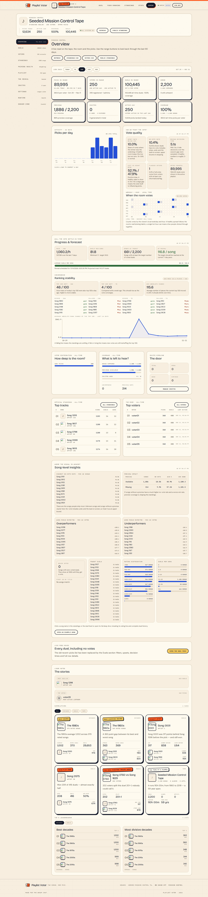 |  |
| Duels | 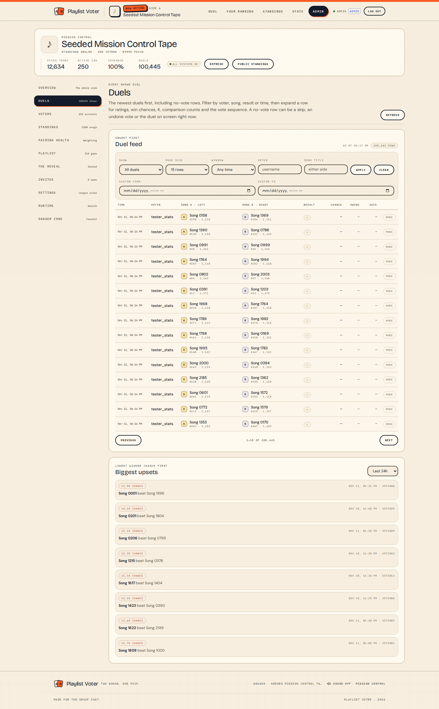 | 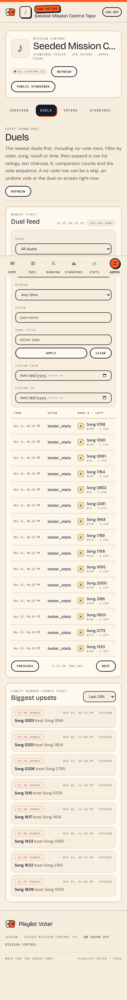 |
| Voters | 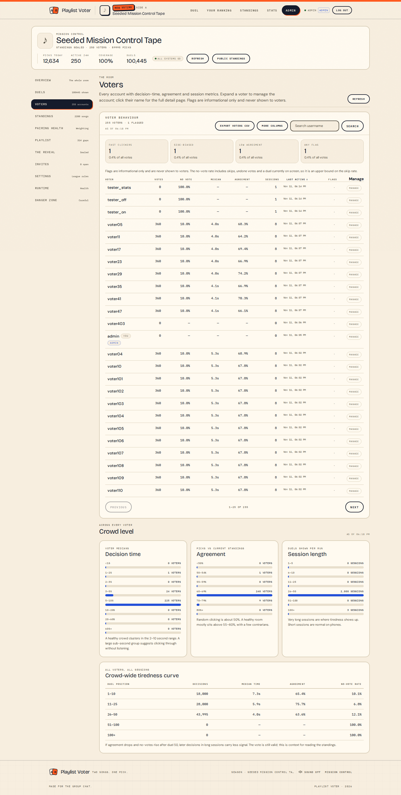 | 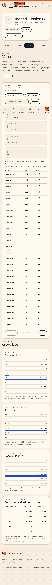 |
| Numbered page jump (voters) | 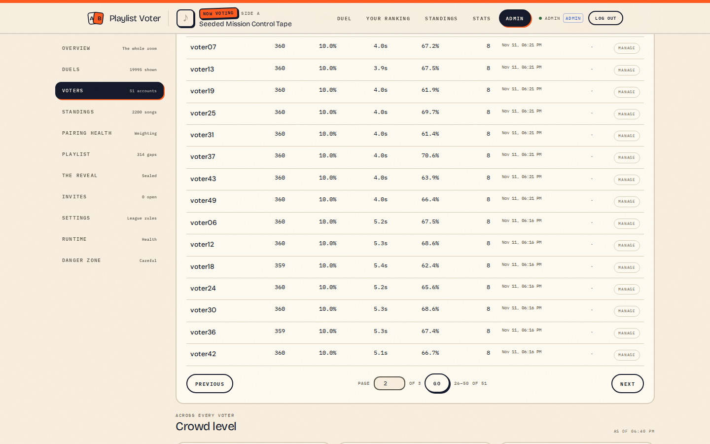 | |
| Standings (more columns) | 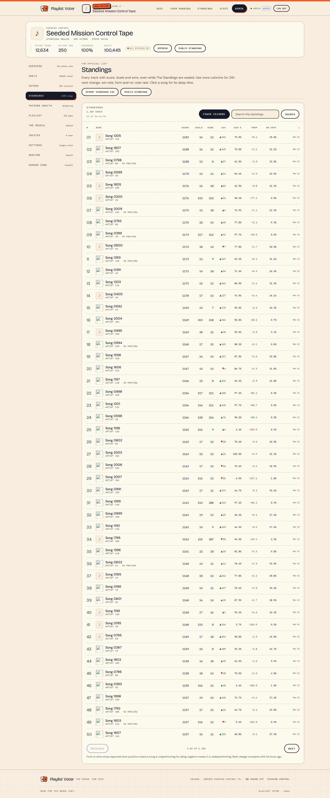 | |
| Numbered page jump (standings) | 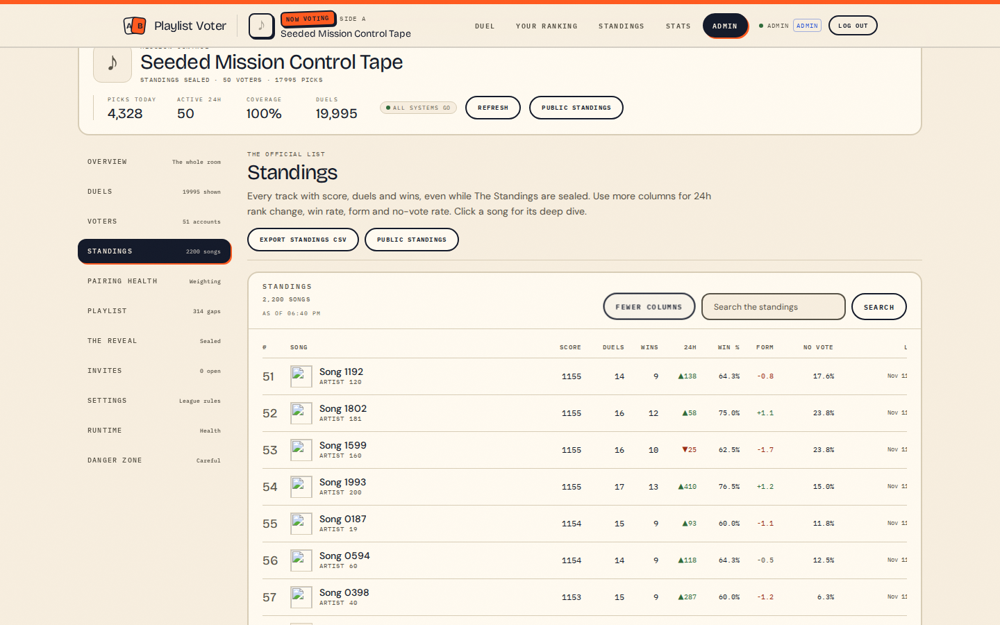 | |
| Pairing health | 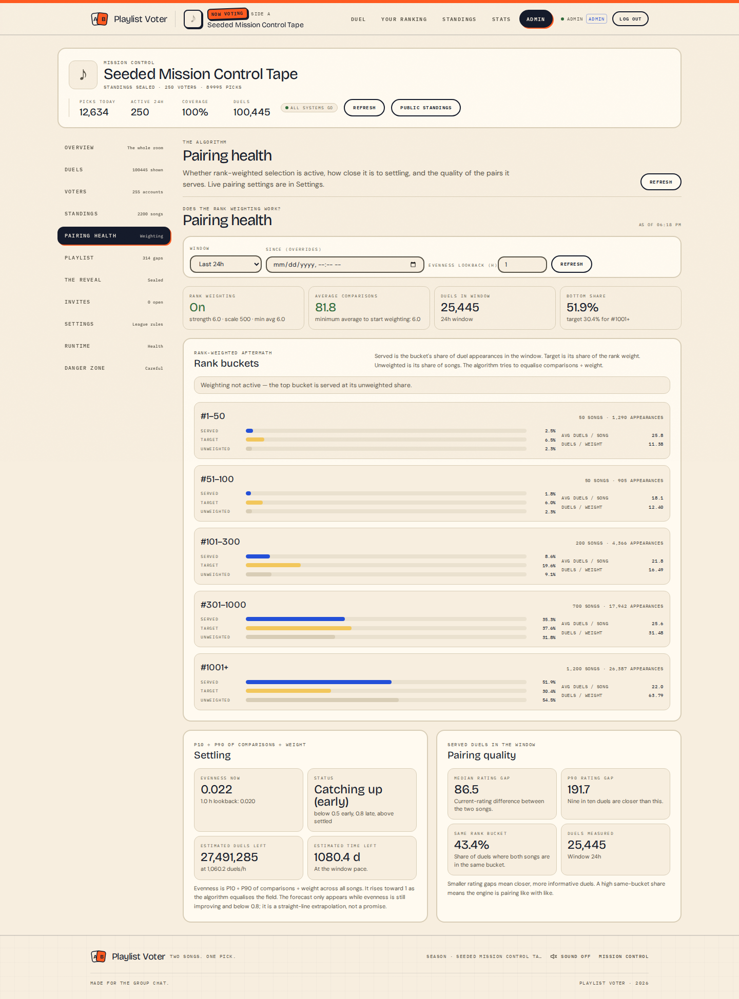 | 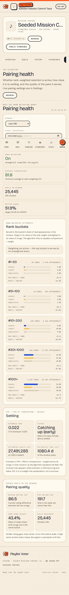 |
| Settings | 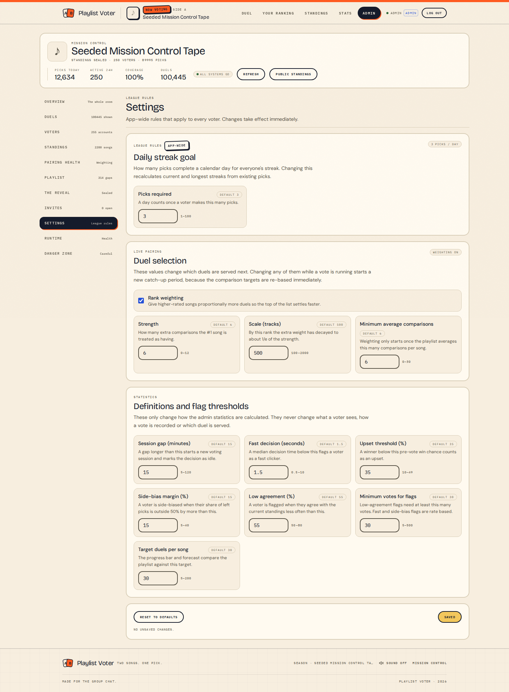 | 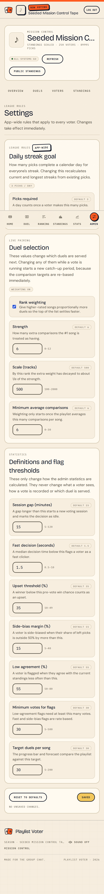 |
| Live-pairing confirmation | 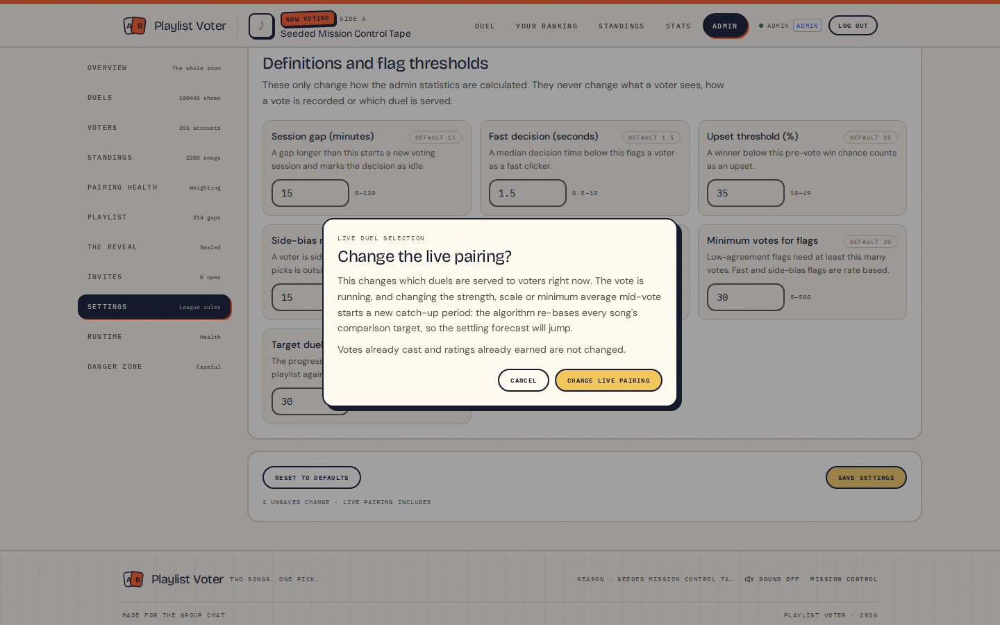 | |
| Song deep dive | 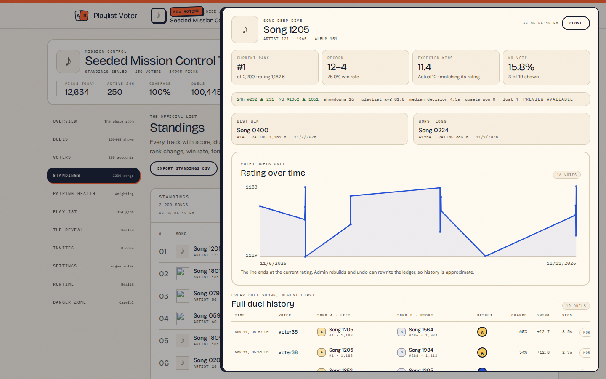 | |
| Voter detail | 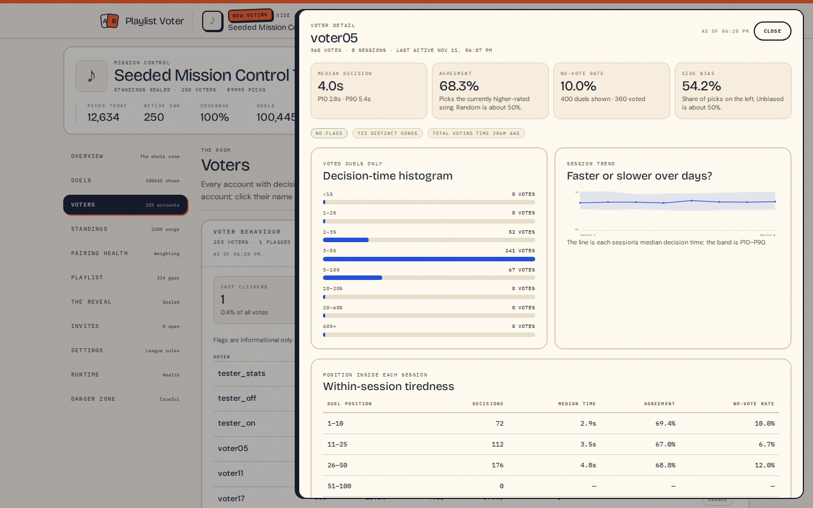 | |

## Approximations and notes

- **History is approximate.** Undo and admin rebuilds rewrite the vote ledger;
  there is no undo log, so an undone vote is indistinguishable from a skip. The
  UI labels no-vote rows “no vote” and explicitly says the no-vote rate is an
  upper bound on skipping.
- **Rank-as-of** is reconstructed from each track's latest vote before the
  timestamp (`rating_before + delta`), with unseen tracks at 1000. Current rank
  uses `ORDER BY rating DESC, id ASC` for determinism. The public chart keeps
  its own existing ordering.
- **Settling forecast** uses the specified `duels_in_window * ln(0.1 / (0.9 -
  even_now)) / ln((0.9 - even_now) / (0.9 - even_then))` formula with the
  required guards. On the seeded (partly random) data evenness improves only
  slightly, so the estimate can be extremely large; it is shown with a
  low-sample warning below 1,000 duels but is not otherwise capped, because it
  is a straight-line extrapolation.
- **Verdict thresholds** use ±3 percentage points for “served ≈ target/unweighted”
  and the named evenness constants `0.5`, `0.8`, `0.9`.
- **Caching.** The first load of the heaviest aggregates at 100k is ~1–2 s; the
  short cache makes interactive use fast. This is a deliberate trade-off
  allowed by the brief, and the UI shows the computation time.
- **No separate undo logging** was added, as required.
- **No new npm dependencies** were added. No migrations were touched. The
  backend was built and tested in the provided Rust container; the UI was
  served by the backend and clicked through with Playwright.
